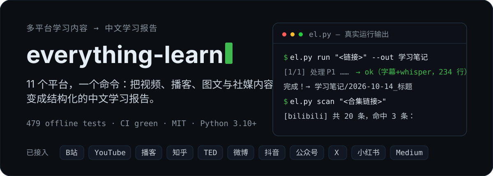
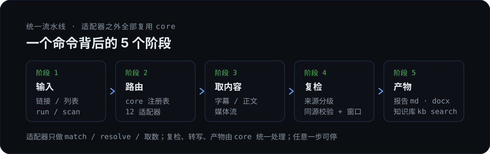

# everything-learn

<p align="center">
  
</p>

<p align="center">
  <a href="https://github.com/getfunWindz/everything-learn/actions/workflows/tests.yml"></a>
  <a href="LICENSE"></a>
  
  
</p>

<p align="center">
  <b>一切知识皆力量</b> · <i>Knowledge is Power</i>
</p>

<p align="center">
  <a href="#中文">中文</a> · <a href="#english">English</a>
</p>

---

## 中文

**一切知识皆力量**：12 个平台，一个命令——把视频、播客、图文与社媒内容整理成结构化的中文学习报告。
来源分级（AI 字幕 → Whisper 主选 / 人工·官方 → 同源校验）→ 档位评分 → 预算闸门 → 3 帧/秒窗口复检；账号级内容（收藏 / 关注 / 合集 / 主页）可枚举、筛选、批量出合集。

### 发布前自检与运维

```bash
python scripts/report_check.py "<报告.md>" --content "<content.txt>" [--strict]
python scripts/el.py split "<产物目录>" --chunk-chars 20000   # 超长内容分块写报告
python scripts/canary.py --only v2ex,zhihu,bilibili           # 真实平台探测（建议本地定时）
```

- `report_check`：结构/编号/自测/术语 + 数字、金句、时间戳回溯（`--strict` 严格模式）。
  - 注：`run` 自动生成的 `<标题>学习报告.md` 是**机械基线**（不含 `#### 知识点`），`report_check` 通常需按 R1–R13 深化后才会 PASS；不要把基线直接当成交付。
- `canary`：12 平台 meta 探测（`--full` 含内容），JSON 结果；网络/风控原因**不放进 GitHub CI**。
- 密钥/cookie 文件在 POSIX 下自动 `chmod 600`。

## 平台能力

| 平台 | 形态 | 能力 |
|---|---|---|
| B 站 | timeline | ✅ 链接/BV/av/名称搜索/收藏夹；多 P、UP 主视频列表（wbi）、稍后再看 / 历史 / 关注 |
| YouTube | timeline | ✅ 人工字幕优先（含中文翻译轨）、自动字幕滚动去重、429 退避与多语言轨回退 |
| 播客（RSS / Apple） | timeline | ✅ `podcast:transcript` 直接解析，无转写稿走音频 Whisper |
| TED | timeline | ✅ 官网官方字幕（多语含简中），无字幕时 mp4 → Whisper |
| 知乎 | document | ✅ 文章 / 回答 / 问题（`--all` 展开）；用户回答与收藏夹 items 扫描 |
| 微博 | document | ✅ 单帖 / 时间线 / **我的收藏** / **关注**（需 cookie） |
| 抖音 | timeline | ✅ 单视频（浏览器上下文 + Whisper）；主页 / 收藏 / 喜欢扫描（需登录） |
| 微信公众号 | document | ✅ 单篇直连（无需 cookie）；**合集（album）扫描**；搜狗搜索实验性 |
| X（Twitter） | document | ✅ 单推文（含视频口播转写）；主页时间线扫描（需登录 + 代理） |
| 小红书 | document | ✅ 单笔记（视频附口播转写）；主页（含分页）/ 收藏枚举（需登录） |
| Medium | document | ✅ 文章（SSR 抽取）/ feed / **书签列表**扫描（需登录） |
| V2EX | document | ✅ 主题正文 + 前排回复（公开 API + 页面解析，无需 cookie） |
| 名单外平台 | — | 自进化流程现场接入：尽调 → 搭建 → 三件套（`el.py platforms` 查名单） |

**一次完整运行的产物**（每个条目三件套 + 基线报告 + 图片资产）：

```text
学习笔记/<作者>/<标题>/
├── content_info.json      # 元信息、来源、assets 清单
├── content.txt            # 逐行带时间轴的转写 / 正文
├── report_template.md     # 中文学习报告骨架
├── <标题>学习报告.md       # run 自动生成的机械基线（需按 R1–R13 深化）
├── recheck_report.json    # timeline 复检留痕（图文平台无此文件）
└── assets/                # 正文图片
```

### 怎么工作

<p align="center">
  
</p>

- **适配器只做路由与取数**：`match → resolve → list_items → fetch_meta → fetch_content → fetch_media_url`，并声明内容来源（`provenance`/`language_hint`）。
- **保真复检全部在 `core/`**：`core/recheck.py` 统一来源分级 → 同源校验 → 档位评分 → 区域选择 → 预算闸门；多模态复检通道是适配器标准必接项（`fetch_media_url(media="video", lowest=True)`），无画面平台返回 `None` 自动跳过；契约测试会校验签名。
- **产物透明**：档位/评分理由/预算估算/同源校验/交叉比对/不确定项落入 `recheck_report.json`；正文标注【画面补充】【画面校正】，未覆盖区间如实留痕。

### 安装（可选）

直接 `python scripts/el.py ...` 即可。想让任意目录/任意 harness 用 `everything-learn` 命令：

```bash
pipx install --editable .        # 或 uv tool install --editable .
everything-learn --version
```

> 本期只支持 editable 安装（源码/数据仍在仓库内）；非 editable 的 PyPI 包与用户级配置目录迁移暂未做。

## 快速开始

> 以下命令在本仓库根目录执行（即技能目录）。

```bash
# 安装（核心仅 requests + pytest；其余按需）
pip install -r requirements.txt
pip install faster-whisper  # 可选：视频/播客转写（图文平台不需要）
pip install yt-dlp        # 可选：YouTube / 抖音
pip install playwright    # 可选：cookie 导出 / browserfetch（无需 playwright install）

# Whisper：出厂默认 fast=small；实机验证 medium 效果最佳（首次引导会建议升级）

# 首次使用：完成引导（环境自检 + 五项确认：产出目录 / Whisper 档位 / 依赖清单 / 使用说明 / 术语库）
python scripts/el.py onboard             # 查看清单与环境摘要
python scripts/el.py onboard --complete  # 确认完成后置位（标签位 1→0，此后不再触发）

# 用一个根目录存放报告（未配置 out_dir 时 run 会拒绝运行，不设默认路径）
python scripts/el.py run "<视频链接/BV号>" --out "D:/学习笔记"

# 批量与断点续跑
python scripts/el.py run "<BV号>" --all --out "D:/学习笔记"
python scripts/el.py run "<BV号>" --pages "1-10" --out "D:/学习笔记" --resume

# 复检档位与预算（超阈值会展示金额预算卡）
python scripts/el.py run "<链接>" --recheck 2 --out "D:/学习笔记"    # 强制全量（1 定向 / 3 不检）
python scripts/el.py run "<链接>" --budget 1.5 --out "D:/学习笔记"  # 本次运行复检金额总上限
python scripts/el.py run "<链接>" --no-recheck --out "D:/学习笔记"  # 显式豁免复检（产物标注）
```

需要 cookie 的平台一键导出（Playwright + 系统浏览器，首次在窗口内登录一次）：

```bash
python scripts/el.py cookie zhihu        # 或 bilibili / weibo / douyin
python scripts/el.py cookie --list       # 查看已声明导出规格的平台
```

### 账号级扫描（scan → 合集）

`scan` 枚举列表（过滤 / 优先级 / 快照），`run --all` 批量出合集报告：

```bash
# 他人列表
python scripts/el.py scan "https://space.bilibili.com/<mid>" --limit 20     # B站 UP主视频
python scripts/el.py scan "https://www.zhihu.com/collection/xxxx" --priority
python scripts/el.py scan "https://www.youtube.com/@NASA" --limit 5

# 自己的数据（需登录 / cookie）
python scripts/el.py scan "https://weibo.com/u/favorites" --limit 20        # 微博收藏
python scripts/el.py scan "https://weibo.com/u/page/follow/<uid>"           # 微博关注
python scripts/el.py scan "https://medium.com/@<handle>/list/reading-list"  # Medium 书签
python scripts/el.py scan "https://www.douyin.com/user/self" --limit 20     # 抖音收藏
python scripts/el.py scan "https://www.xiaohongshu.com/user/profile/xxxx?tab=collect"
python scripts/el.py scan "https://mp.weixin.qq.com/mp/appmsgalbum?__biz=..&action=getalbum&album_id=.."
python scripts/el.py toview / history --limit 10 / following                # B站账号数据

python scripts/el.py run "<上面的链接>" --all --out "D:/学习笔记"           # 批量出合集
```

其他常用命令：

```bash
python scripts/el.py search --platform wechat "关键词"     # 公众号搜索（实验性，结果会话绑定）
python scripts/glossary.py add "<术语>" "<解释>"           # 术语库填塞/沉淀（add/alias/clean/absorb）
python scripts/el.py platforms                            # 已注册平台名单 + 自进化入口
python scripts/el.py doctor                               # 环境自检（cookie / GPU / whisper / vision）
python scripts/el.py export "<报告目录>" --format html    # 或 docx
```

### 平台细节

- **复检与成本**：AI 字幕不再直接入库（转 Whisper，字幕留作交叉比对）；人工/官方字幕先过同源校验；复检档位 1/2/3（档3 需白名单、默认关闭），档1 定向、档2 全量（3 帧/秒 + 静帧去重）；金额超阈值先出预算卡。
- **B 站**：AI 字幕（`lan=ai-*`）→ Whisper 主选（AI 字幕留作双 ASR 交叉比对）；人工字幕先过同源校验；评分定档后执行窗口复检（默认 fast=small，建议升 medium——实机最佳；长视频默认禁 VAD）。
- **YouTube**：自动字幕为滚动式，已做重复清洗并标注「字幕(自动)」；自动翻译轨被限流时自动回退其它语言轨。
- **播客 / TED**：播客纯音频——档位复检记 n/a，仅同理源校验；TED 官方字幕优先（同源校验 + 档位复检照常）。
- **知乎 / 公众号 / Medium**：SSR 正文 → 章节式报告；公众号图片走 `data-src` 懒加载链，Medium 走 SSR 块抽取。
- **微博 / X / 小红书 / 抖音**：社交内容映射为 document；X / 小红书视频帖附「视频口播内容」+ lite 档位复检（`recheck_report.json`，窗口级复检为后续项）；均按平台缓速（6–12s）并给出可读的风控提示。
- **反爬纪律**：平台级缓速 + 退避重试 + 持久化浏览器 profile（Cloudflare / 签名平台统一走 `browserfetch`，不逆向签名）。
- **术语库反哺链（0.4.0）**：每次转写按勘误别名自动筛验术语名（`content_info.glossary` 留痕）；画面校正自动沉淀别名；报告写作沉淀新术语；`glossary.py absorb <wiki目录>` 从知识库吸收。初启可填塞自有术语；配套 `bilibili-to-wiki` 可将任意支持平台的内容入库到 llm-wiki 知识库。
- **低配可用（0.3.0）**：仅 `requests` 环境——图文平台可用；字幕平台自动降级（标注「低配：未经同源校验」+ `quality_hint` 推荐补依赖/升 medium）；whisper 平台给安装引导；画面复检依赖缺失时自动跳过。转写档位低于 medium 时产物带 `quality.tier_note` 常驻建议。

### 更新

- 本仓库**不会自动推送到已部署副本**：`git clone` 部署需手动更新；直接复制文件部署需重新复制（无自动更新机制）。
- **一键更新（推荐）**：`python scripts/update.py`（或 `python scripts/el.py update`）——自动处理引导标签位：丢弃本地标签位改动 → `git pull --ff-only` → 按原状态恢复（已引导则自动 `--complete`）；其他本地改动自动 stash/pop；`--dry-run` 可先看计划。
- 手动等价：`git stash` → `git pull` → `python scripts/el.py onboard --complete`。
- 重新引导：`python scripts/el.py onboard --reset`（标签位回 1，下次使用重新展示确认清单）。

### 测试与工程

```bash
python -m pytest tests/ -q     # 931 passed, 2 skipped（933 collected；全部 mock 网络，约 2 分钟）
```

- **CI**：GitHub Actions（Windows / macOS / Ubuntu × Python 3.10 / 3.11）。
- **架构**：`core/`（契约、注册表、配置、缓存、重试、缓速、流水线、保真复检 `recheck.py`、产物、HTML→块、图片下载）+ `providers/`（每平台一个适配器；B 站为参考实现）。
- **自进化**：名单外平台按 `docs/ADAPTER_SPEC.md` §6 尽调 → `docs/ADAPTER_TEMPLATE.md` + `scripts/providers/_template.py` 搭建 → fixture / 契约 / 冒烟三件套；未通过不合入。
- **上游**：[bilibili-learn](https://github.com/getfunWindz/bilibili-learn)（只做 B 站的轻量版，保持原样）。

### License

[MIT](LICENSE) · 变更记录见 [CHANGELOG.md](CHANGELOG.md)

---

## English

**Knowledge is Power**: 12 platforms, one command — turn videos, podcasts, articles and social posts into structured Chinese study reports.
Provenance grading (AI subtitles → Whisper-first / human·official → same-source verification) → tier scoring → budget gate → 3-fps window recheck. Account-level content (favorites / follows / collections / profiles) can be enumerated, filtered, and digested in batches.

### Platform support

| Platform | Kind | Capabilities |
|---|---|---|
| Bilibili | timeline | ✅ Links/BV/av/name search/favorites; multi-part, UP uploads (wbi), watch later / history / following |
| YouTube | timeline | ✅ Manual subtitles first (incl. Chinese translations), rolling auto-caption dedup, 429 backoff with track fallback |
| Podcasts (RSS / Apple) | timeline | ✅ Native `podcast:transcript` parsing; otherwise audio → Whisper |
| TED | timeline | ✅ Official subtitles (multi-language incl. zh-cn); no subtitles → mp4 → Whisper |
| Zhihu | document | ✅ Articles / answers / questions (`--all`); user answers & collection item scans |
| Weibo | document | ✅ Single post / timeline / **favorites** / **following** (cookie required) |
| Douyin | timeline | ✅ Single video (browser context + Whisper); profile / favorites / likes scans (login required) |
| WeChat MP | document | ✅ Single article (no cookie); **album scans**; Sogou search (experimental) |
| X (Twitter) | document | ✅ Single tweet (incl. video speech-to-text); profile timeline scan (login + proxy) |
| Xiaohongshu | document | ✅ Single note (video speech-to-text); profile (paginated) / favorites enumeration (login required) |
| Medium | document | ✅ Article (SSR extraction) / feed / **bookmark list** scans (login required) |
| V2EX | document | ✅ Topic body + first-page replies (public API + page parsing, no cookie) |
| Unlisted platforms | — | Self-evolution flow: due diligence → scaffold → test triad (`el.py platforms` to list) |

**Artifacts of one full run** (per item: 3-file bundle + baseline report + image assets):

```text
notes/<author>/<title>/
├── content_info.json      # metadata, source, assets list
├── content.txt            # timestamped transcript / body text
├── report_template.md     # Chinese study report skeleton
├── <title>学习报告.md      # baseline auto-generated by run (deepen per R1–R13)
├── recheck_report.json    # timeline recheck evidence (absent for document platforms)
└── assets/                # inline images
```

### How it works

<p align="center">
  
</p>

- **Adapters only route and fetch**: `match → resolve → list_items → fetch_meta → fetch_content → fetch_media_url`, declaring content provenance (`provenance`/`language_hint`).
- **Fidelity recheck lives in `core/`**: `core/recheck.py` handles provenance grading → same-source verification → tier scoring → region selection → budget gate. The multimodal recheck channel is a mandatory adapter hook (`fetch_media_url(media="video", lowest=True)`); audio-only platforms return `None` and are skipped automatically; contract tests enforce the signature.
- **Transparent artifacts**: tier / score reasons / budget estimates / same-source results / cross-checks / uncertainties land in `recheck_report.json`; inline 【画面补充】【画面校正】 markers, uncovered ranges recorded honestly.

### Quick start

> Run from the repo root (the skill directory).

```bash
# Install (core needs only requests + pytest; extras optional)
pip install -r requirements.txt
pip install faster-whisper  # optional: video/podcast transcription (not needed for articles)
pip install yt-dlp        # optional: YouTube / Douyin
pip install playwright    # optional: cookie export / browserfetch (no `playwright install` needed)

# Whisper: factory default is fast=small; real-world testing shows medium is best (onboarding recommends it)

# First run: complete onboarding (env check + 5 confirmations: out dir / Whisper tier / deps / usage / glossary)
python scripts/el.py onboard             # show checklist and env summary
python scripts/el.py onboard --complete  # mark done (flag 1→0; never asked again)

# Pick an output root for reports (run refuses to start without out_dir; no default path)
python scripts/el.py run "<video url/BV>" --out "D:/notes"

# Batch & resume
python scripts/el.py run "<BV>" --all --out "D:/notes"
python scripts/el.py run "<BV>" --pages "1-10" --out "D:/notes" --resume

# Recheck tier & budget (a budget card appears above the threshold)
python scripts/el.py run "<url>" --recheck 2 --out "D:/notes"    # force full (1 targeted / 3 off)
python scripts/el.py run "<url>" --budget 1.5 --out "D:/notes"   # per-run recheck spending cap
python scripts/el.py run "<url>" --no-recheck --out "D:/notes"   # explicit exemption (annotated)
```

One-command cookie export for platforms that need it (Playwright + system browser; log in once):

```bash
python scripts/el.py cookie zhihu        # or bilibili / weibo / douyin
python scripts/el.py cookie --list       # list platforms with export specs
```

### Account-level scanning (scan → collections)

`scan` enumerates lists (filter / priority / snapshot); `run --all` produces collection reports:

```bash
# Other people's lists
python scripts/el.py scan "https://space.bilibili.com/<mid>" --limit 20     # Bilibili uploads
python scripts/el.py scan "https://www.zhihu.com/collection/xxxx" --priority
python scripts/el.py scan "https://www.youtube.com/@NASA" --limit 5

# Your own data (login / cookie required)
python scripts/el.py scan "https://weibo.com/u/favorites" --limit 20        # Weibo favorites
python scripts/el.py scan "https://weibo.com/u/page/follow/<uid>"           # Weibo following
python scripts/el.py scan "https://medium.com/@<handle>/list/reading-list"  # Medium bookmarks
python scripts/el.py scan "https://www.douyin.com/user/self" --limit 20     # Douyin favorites
python scripts/el.py scan "https://www.xiaohongshu.com/user/profile/xxxx?tab=collect"
python scripts/el.py scan "https://mp.weixin.qq.com/mp/appmsgalbum?__biz=..&action=getalbum&album_id=.."
python scripts/el.py toview / history --limit 10 / following                # Bilibili account data

python scripts/el.py run "<list url above>" --all --out "D:/notes"          # collection reports
```

Other commands:

```bash
python scripts/el.py search --platform wechat "keyword"   # WeChat search (experimental, session-bound)
python scripts/glossary.py add "<term>" "<gloss>"         # seed/enrich glossary (add/alias/clean/absorb)
python scripts/el.py platforms                            # registered platforms + self-evolution entry
python scripts/el.py doctor                               # env self-check (cookie / GPU / whisper / vision)
python scripts/el.py export "<report dir>" --format html  # or docx
```

### Platform notes

- **Recheck & cost**: AI subtitles never enter the report directly (Whisper-first; subtitles kept for cross-checking). Human/official subtitles pass same-source verification first. Recheck tiers 1/2/3 (tier 3 whitelisted, off by default): tier 1 targeted, tier 2 full (3 fps + still-frame dedup). Budget card appears above the threshold.
- **Bilibili**: AI subtitles (`lan=ai-*`) → Whisper-first (kept as second ASR opinion); manual subtitles go through same-source verification; window recheck after tier scoring (default fast=small, medium recommended; long videos disable VAD by default).
- **YouTube**: rolling auto-captions are deduplicated and labeled 「字幕(自动)」; throttled auto-translated tracks fall back to other languages automatically.
- **Podcast / TED**: podcasts are audio-only — recheck recorded as n/a, same-source check still applies; TED official subtitles first (verification + recheck as usual).
- **Zhihu / WeChat MP / Medium**: SSR body → chaptered reports; WeChat images use the `data-src` lazy-load chain, Medium uses SSR block extraction.
- **Weibo / X / Xiaohongshu / Douyin**: social content maps to `document`; X / Xiaohongshu video posts include a "video speech" block + lite recheck (`recheck_report.json`; window-level recheck is future work); per-platform rate limits (6–12s) with readable risk-control messages.
- **Anti-bot discipline**: platform rate limits + backoff retries + persistent browser profile (Cloudflare / signed platforms all go through `browserfetch`; no signature reverse-engineering).
- **Glossary feedback loop (0.4.0)**: every transcript is checked against alias corrections (`content_info.glossary`); visual corrections auto-enrich aliases; report writing adds new terms; `glossary.py absorb <wiki>` absorbs from your knowledge base. Seed your own terms during onboarding; the companion `bilibili-to-wiki` skill ingests any supported platform into an llm-wiki knowledge base.
- **Low-dependency mode (0.3.0)**: with only `requests` — document platforms work; subtitle platforms degrade gracefully (annotated 「低配：未经同源校验」 + `quality_hint` recommending deps/medium); Whisper platforms print install guidance; missing frame-recheck deps (Pillow/PyAV) skip automatically. Below-medium tiers get a persistent `quality.tier_note`.

### Updates

- This repo **does not auto-push to deployed copies**: `git clone` deployments need manual updates; file copies need re-copying (no auto-update mechanism).
- **One-command update (recommended)**: `python scripts/update.py` (or `python scripts/el.py update`) — handles the onboarding flag automatically: discard local flag change → `git pull --ff-only` → restore previous state (auto `--complete` if onboarded); other local changes are stashed/popped; `--dry-run` previews the plan.
- Manual equivalent: `git stash` → `git pull` → `python scripts/el.py onboard --complete`.
- Re-run onboarding: `python scripts/el.py onboard --reset` (flag back to 1).

### Testing & engineering

```bash
python -m pytest tests/ -q     # 931 passed, 2 skipped (933 collected; all network mocked, ~2 min)
```

- **CI**: GitHub Actions (Windows / macOS / Ubuntu × Python 3.10 / 3.11).
- **Architecture**: `core/` (contracts, registry, config, cache, retry, throttle, pipeline, fidelity recheck `recheck.py`, artifacts, HTML→blocks, image download) + `providers/` (one adapter per platform; Bilibili is the reference implementation).
- **Self-evolution**: unlisted platforms go through `docs/ADAPTER_SPEC.md` §6 due diligence → `docs/ADAPTER_TEMPLATE.md` + `scripts/providers/_template.py` scaffold → fixture / contract / smoke triad; nothing merges without passing.
- **Upstream**: [bilibili-learn](https://github.com/getfunWindz/bilibili-learn) (Bilibili-only lightweight edition, kept as-is).

### License

[MIT](LICENSE) · see [CHANGELOG.md](CHANGELOG.md)
